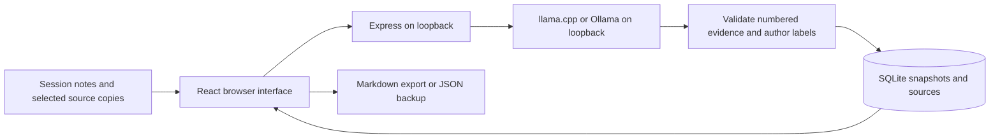

# Architecture

Resume Button has one browser interface, one local API, one SQLite database, and a separate local inference process.

## Responsibilities

- `src/App.tsx` manages project navigation, capture, drafts, cards, history, source inspection, and focus sessions.
- `src/BackupPanel.tsx` previews an imported backup and requests a restore.
- `server/app.ts` validates requests and coordinates project, scan, capture, export, and backup endpoints.
- `server/model.ts` calls either local inference protocol. A 180-second combined timeout bounds generation and one repair attempt.
- `server/inference.ts` numbers meaningful lines, validates selected IDs, preserves explicit labels, derives recaps from selected text, and anchors suggestions.
- `server/sources.ts` scans a bounded folder tree and optional Git context.
- `server/store.ts` stores immutable snapshots and source copies. Backups restore in a transaction with new project and snapshot IDs.
- `shared/session.ts` serializes guided/free notes and restores browser drafts.
- `shared/validation.ts` and `server/backup.ts` enforce input limits and backup integrity.

A new card is saved only after successful inference and validation. The example is handwritten and labelled. Original cards retain the sources and interpretation that were saved at the time.

## Cancellation

The browser aborts its request when the user cancels or capture unmounts. The server watches the unfinished response closing, aborts its model request, checks the signal before saving, and releases the single generation slot in `finally`. Providers must cooperate with HTTP cancellation to stop their own computation.

## Storage

Projects and snapshots use `node:sqlite` in WAL mode. Foreign keys cascade only when a project is explicitly removed. A seed marker prevents the fictional example reappearing after the user deletes every project.

Drafts use localStorage on the current browser origin. They include both note modes, imported/scanned text, selected source IDs, and scan metadata. They clear after a successful save. Database backups exclude browser drafts and folder attachments.

## Local boundary

Both services bind to loopback. The API validates Host, Origin, content type, input size, and source ownership. Model URLs must be HTTP loopback origins and cannot redirect. No account, telemetry, cloud inference, or synchronization is implemented.

The scanner skips common secret filenames, hidden/dependency/build directories, and symbolic links. Filename filtering cannot identify every sensitive document. Saved text and backups are plaintext.

## Verification

Unit tests cover evidence and model protocols. API tests cover mutations, ownership, invalid requests, cancellation, and backup recovery. Playwright uses a deterministic generator and in-memory database on port 4190. Real inference is verified separately to avoid confusing fixture coverage with model quality.
