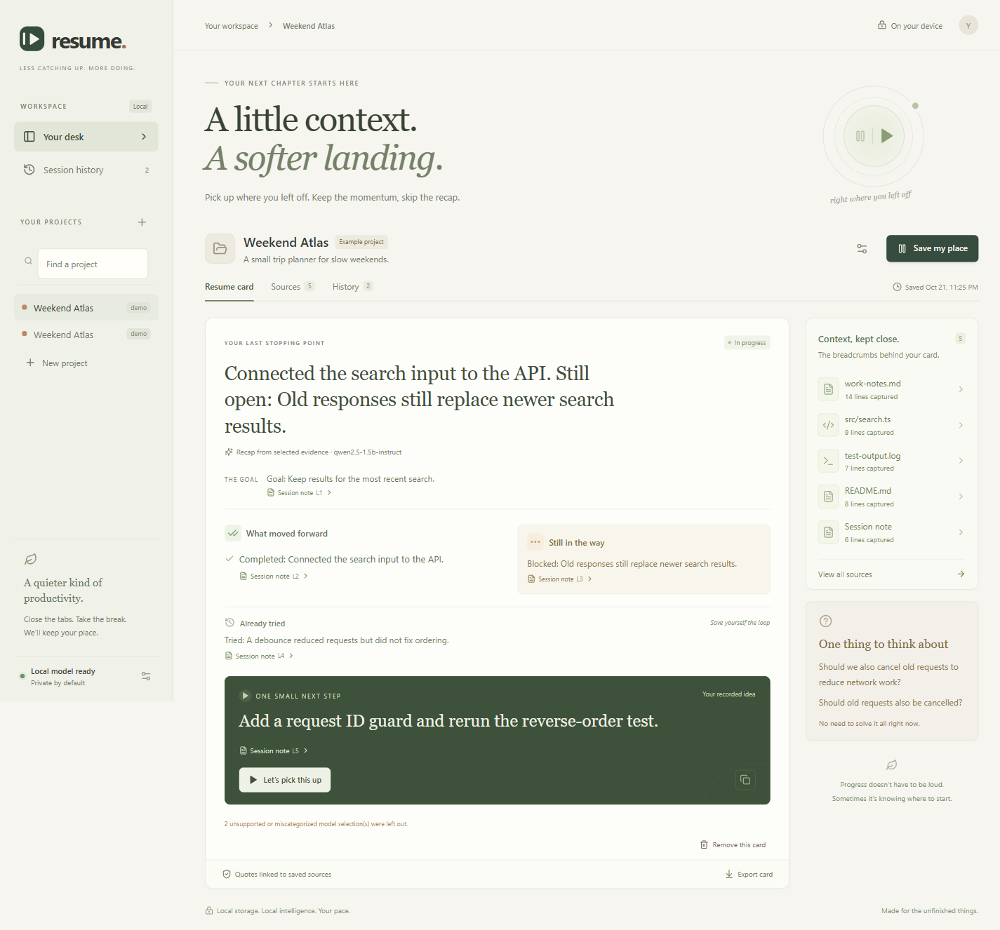
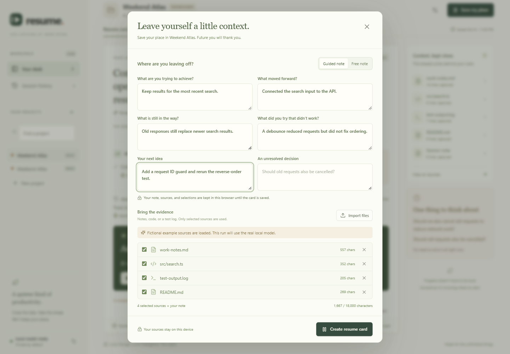
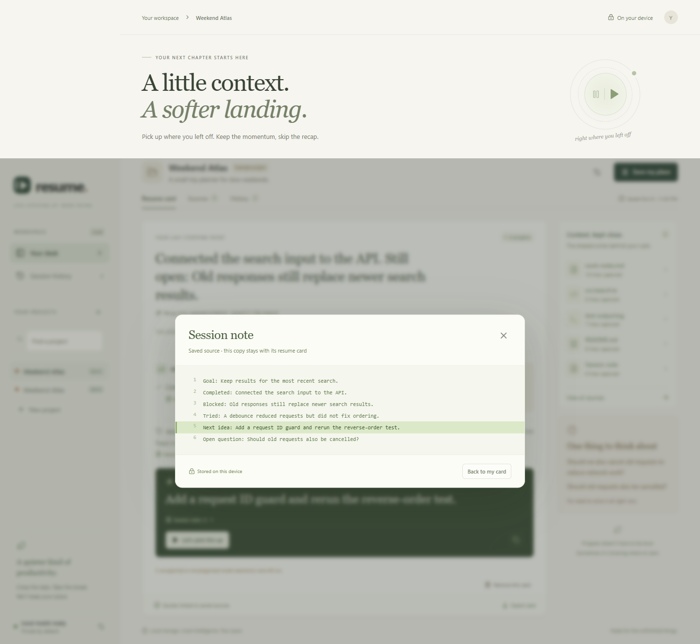
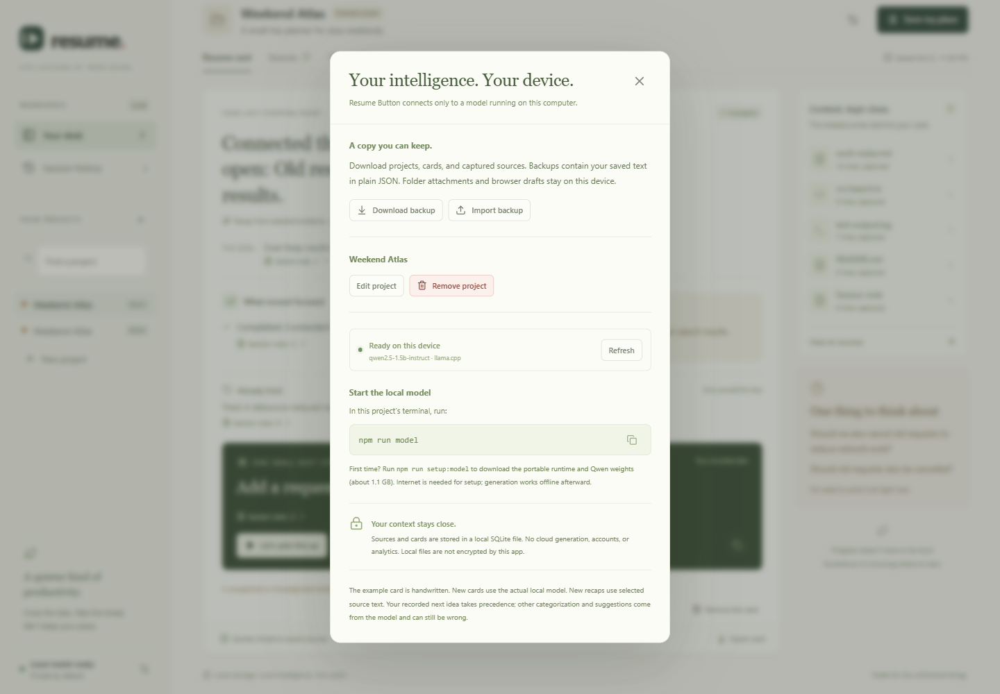
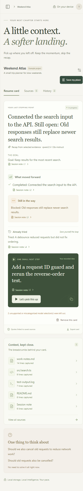

# Demo

The repository includes [a short walkthrough](media/resume-button-demo-short.webm) and [the full real-model recording](media/resume-button-demo.webm). Verification output stays under `artifacts/demo/` in the working project. Screenshots are under `docs/images/`.

## Recording

- `resume-button-demo.webm`: full 102-second browser flow with real Qwen inference, cancellation/retry, cited lines, export, focus, history, and restore. No narration.
- `resume-button-demo-short.webm`: a shorter walkthrough of the saved real-model card, source inspection, guided capture, backups, focus, and mobile layout. It does not run generation again.
- `verification.json`: model, measured generation time, and checked outcomes.
- `real-model-card.json` and `resume-card.md`: saved output from the fictional Weekend Atlas task.

These runs used a separate database and did not remove user cards.

## Two-minute walkthrough

1. Open the app and show the labelled Weekend Atlas example.
2. Select **Save my place** and record goal, progress, blocker, failed attempt, and next idea.
3. Choose a few source files. Explain that selected text is copied into the saved card.
4. Start generation. Show the elapsed time and cancellation control; cancel once to demonstrate draft recovery.
5. Generate again. On slower CPUs, prepare this card before a live talk or explicitly cut the wait.
6. Show that the completed work and remaining blocker both appear. The recorded next idea has a distinct label.
7. Click its source link and inspect the exact saved line.
8. Export Markdown, revisit History, and start a focus session.
9. Open local settings, download a backup, and explain that restore adds copies.

The card helps recover context; it does not fix the sample search implementation.

## Screenshots

