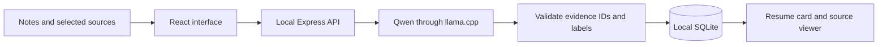

*This is a submission for the [Hacktoberfest Open-Source AI Challenge Week 3: Slow and Steady](https://dev.to/challenges/hacktoberfest-week3-2026-10-19).*

## What I Built

Resume Button is a local assistant for the moment you return to an unfinished project and cannot remember where you stopped.

Before a break, leave a short note and select a few source files or a test log. The app creates a resume card: the goal, what moved forward, what is still blocking you, what you already tried, and one next step. Every evidence quote opens its saved source at the cited line.

It is designed for a gentler restart. The intended payoff is less time reconstructing context across notes, code, and logs.

## Demo

The recorded demo uses Qwen2.5-1.5B-Instruct on the local CPU with a fictional trip planner called Weekend Atlas. An older search response is replacing a newer one. The saved card keeps that blocker visible and preserves the author's next idea: add a request ID guard.

The full recording also demonstrates cancellation, retained drafts, Markdown export, history, a focus session, and backup restore.

[Watch or download the 18-second demo](https://github.com/AdityaAneNenu/resume-button/raw/refs/heads/main/docs/media/resume-button-demo-short.webm). This walkthrough shows the saved real-model card, source inspection, capture, backup settings, focus, and mobile layout.

[Full 102-second recording with real generation and cancellation](https://github.com/AdityaAneNenu/resume-button/raw/refs/heads/main/docs/media/resume-button-demo.webm).


## Code

The application is MIT licensed. The source release includes the application, tests, setup scripts, documentation, and fictional demo context. Model weights and llama.cpp binaries download separately with pinned checksums.

[Source code, setup instructions, and tests on GitHub](https://github.com/AdityaAneNenu/resume-button).

Run it on Windows with Node.js 22.13 or newer:

```powershell
git clone https://github.com/AdityaAneNenu/resume-button.git
cd resume-button
npm ci
npm run setup:model
npm run build
npm run local:production
```

Open `http://127.0.0.1:4173`. Setup downloads about 1.1 GB of verified runtime/model files; generation works offline afterward.

## How I Built It

The interface uses React and Vite. Express serves a loopback API, SQLite stores cards and source copies, and llama.cpp serves the official Qwen2.5-1.5B-Instruct Q4_K_M weights. An existing local Ollama service can also be used.

The important design choice is how the model returns evidence. It selects numbered source lines instead of composing quotes. The server resolves those IDs into exact source text and excludes invalid or contradictory selections. Explicit author labels take precedence; a recorded next idea is preserved. New recaps are assembled from selected evidence so a blocker cannot be smoothed into an invented success story.

If no next idea is recorded, the model can propose a clearly labelled suggestion with source references. Those references make it inspectable, not necessarily correct.

Cancellation propagates from the browser to Express and the inference request. The server checks cancellation before saving. Backup restore validates saved evidence and adds independent copies in a transaction.



Verification includes 30 unit/API tests, three reusable browser flows, a TypeScript/production build, formatting, and a real Qwen production run. The real run generated a card in 92.1 seconds and reported no page errors or remote browser requests. Cancelled generation saved no snapshot; the next generation succeeded.

The model is small. It can miss or misclassify unlabeled prose. Guided notes are more reliable, and matching a quote does not prove an interpretation. CPU speed varies. Streaming is not implemented.

## Why Does Open Innovation Matter?

The open model and runtime are central to the application. They let it generate cards on this computer after setup without a cloud account or per-card API fee. Notes and source files can stay on the device. The inference endpoint can be replaced, and the prompt and evidence rules can be inspected and changed.

The code is MIT licensed, Qwen uses Apache 2.0, and llama.cpp uses MIT. This makes the underlying choices available to people who want to adapt the workflow to their own projects.

Running locally has a real cost in download size, memory, and CPU time. It also leaves storage under the user's control: sources, SQLite data, drafts, and JSON backups are plaintext and should be handled accordingly.

## What I Learned

Recovery needs the same attention as generation. A successful summary is not useful if cancelling loses the source selection or importing a backup overwrites current work.

Two community articles informed this work: [From TCP to Express: Understanding Request Lifecycles and Cancellation](https://dev.to/silentwatcher_95/from-tcp-to-express-understanding-request-lifecycles-and-cancellation-474c) by [@silentwatcher_95](https://dev.to/silentwatcher_95), on cooperative cancellation, and [Preserve First: Recovery Design for Local Creative Data](https://dev.to/qnbs/preserve-first-recovery-design-for-local-creative-data-6o9) by [@qnbs](https://dev.to/qnbs), on preserving existing work during recovery.

The workflow has been exercised with fictional context, but actual human time saved has not been measured. Generation latency is not a time-savings claim. A useful next evaluation is to compare time to a correct first action with and without a card on matched unfinished tasks.

*AI disclosure: Codex assisted with implementation, verification, and this draft. The author should review the text and evidence before publication.*
